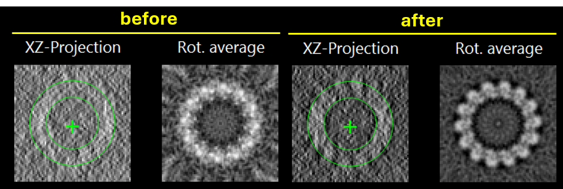

# Refinement on Tilt Series

### Tilt Series Alignment

If the tomogram is [opened from a tilt series](../open_image.md), the alignment of the
tilt series can be refined using the molecules.

:material-arrow-right-thin-circle-outline: API: [`refine_tilt_series`][cylindra.widgets.sta.SubtomogramAveraging.refine_tilt_series]

:material-arrow-right-thin-circle-outline: GUI: `STA widget > Alignment > Refine tilt series`

The subtomograms of all the selected layers are averaged as the reference of all the
molecules. The projections of the average placed at the molecules are compared with the
tilt images, and the shifts of each tilt image are refined.

??? info "List of parameters"
    1. "layers" is the molecules layer(s) used for the refinement. All the layers are
       averaged together, so they should be of the same structure (such as tubulins of
       microtubules).
    2. "size (nm)" is the size of the average. If not given, it tries to use the size
       of the template image.
    3. "max shift (nm)" is the maximum shift of the tilt images.
    4. "grid shape (y, x)" is the number of control points of the local shifts along y
       and x of the tilt images. `(1, 1)` means a uniform shift of each tilt image.
       Otherwise, the shifts are refined as a smooth field over each tilt image.
    5. "smoothness" is the weight of the smoothness prior of the local shifts. Larger
       value is more robust against noise and fewer molecules.
    6. If "apply CTF" is checked, the CTF is applied to the projections of the
       average, with the defocus of each molecule in each tilt (changed by its depth
       in the microscope). The tilt series must have the CTF parameters.
    7. "bin size" is the bin size of the subtomograms used for the average and the
       refinement.
    8. If "update coarse tomogram" is checked, the coarse tomogram for visualization is
       also reconstructed from the refined tilt series, and shown with the same filter
       and inversion.

The molecules should be aligned beforehand. If the tilt series is poorly aligned,
[`align_averaged`][cylindra.widgets.sta.SubtomogramAveraging.align_averaged] usually
works very well.

{ loading=lazy, width=480px }

The shifts of the tilt images are shown in the logger. After the refinement, all the
subtomograms and the images for analysis are reconstructed from the refined tilt
series.

!!! note
    For periodic structures such as microtubules, "max shift (nm)" should be smaller
    than half of the period (about 2 nm for the 4-nm repeat of tubulin), otherwise the
    tilt images may be aligned to the neighboring repeat.

The refined tilt series alignment and the reconstructed coarse tomogram are saved in the
project directory (`tilt_series.json` and `coarse_tomogram.mrc`) when the project is
saved.
